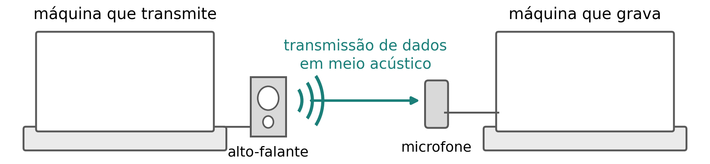
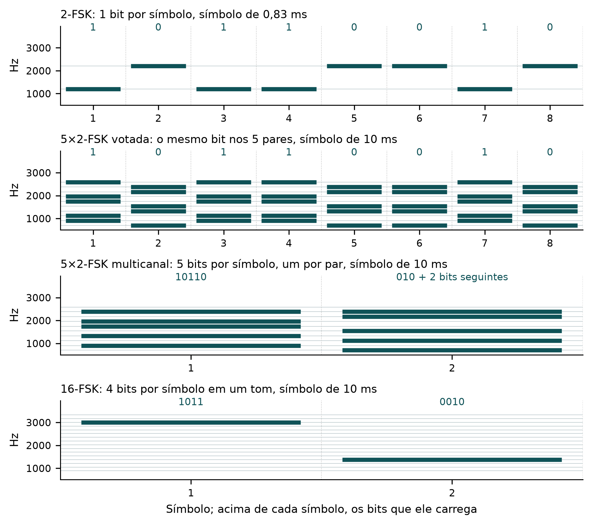
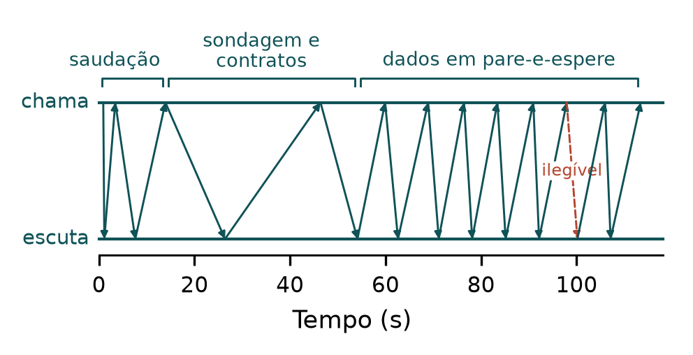
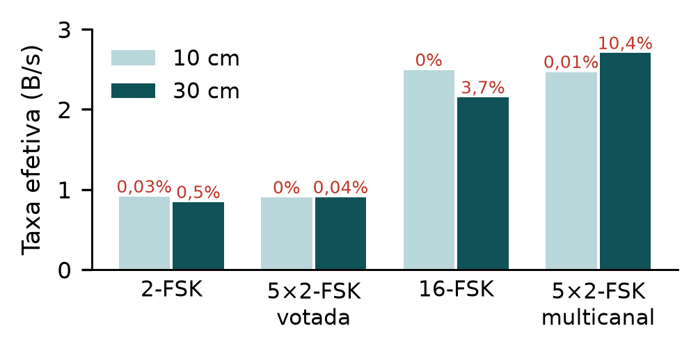
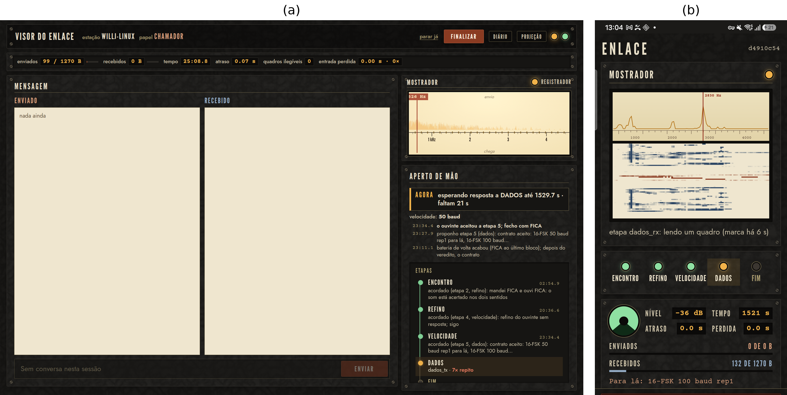

# modem-acustico

Modem acústico: transmite dados como som audível entre dois dispositivos, com alto-falante e microfone comuns. Não usa rede, cabo nem hardware extra. Roda em computador e em celular Android.



## Como funciona

1. Os bytes viram tons, em uma de quatro formas de transmissão.
2. Um código convolucional corrige os bits que chegam errados.
3. Os pacotes levam verificação (CRC) e são retransmitidos quando falham.
4. Antes dos dados, as duas pontas medem o canal pelo próprio som e combinam tons, nível e taxa em cada sentido.

**As quatro formas de transmissão**



**Uma sessão negociada, da chamada aos dados**



## Resultados

Em uma sala, com o alto-falante a aproximadamente 10 e 30 cm do microfone, as quatro formas entregaram o texto idêntico ao enviado, sem retransmissão. Em vermelho, os bits recebidos errados antes da correção.



## Aplicativo

O visor inicia a sessão, mostra o estado do enlace e apresenta os dados recebidos. À esquerda, no computador; à direita, no celular.



## Como usar

Requer Python 3.10+ e PortAudio (`sudo apt install libportaudio2` no Debian/Ubuntu).

```bash
python -m venv venv
./venv/bin/pip install -r requirements.txt
./venv/bin/python src/visor.py
```

O visor abre no navegador. As duas pontas precisam estar no mesmo commit. Escolha **Ouvinte** em uma e **Chamador** na outra, escreva o texto e inicie primeiro o ouvinte.

Para ver uma sessão sem usar o som:

```bash
./venv/bin/python src/visor.py --simulado limpo --out sessoes-sim
```

Para gerar o aplicativo Android:

```bash
JAVA_HOME=<jdk> ANDROID_HOME=<android-sdk> AUDIOFSK_PYTHON310=$(uv python find 3.10) \
    android/gradlew -p android assembleDebug
```

## Organização

```
src/           código do modem, do enlace e do visor
testes/        testes em memória do enlace
android/       aplicativo Android
docs/figuras/  figuras deste README
```

Testes: `PYTHONPATH=src ./venv/bin/python testes/simula_manual.py`

## Autores

Winderson Nascimento da Cruz e Jefferson Wilhelm Meyer Soares (IFPR, Campus Jacarezinho).

Licença MIT.
